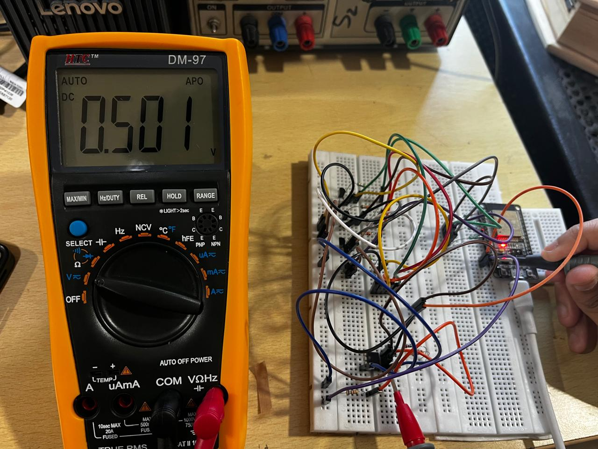

# Programmable Gain Amplifier (ESP32 + MOSFET-switched feedback)

A programmable gain amplifier (PGA) built on a breadboard. An op-amp stage has its feedback resistance selected by MOSFETs, and an ESP32 picks the gain level over serial.

## How it works

- Op-amp based amplifier stage.
- Feedback resistors are switched in and out with MOSFETs.
- An ESP32 drives the MOSFET gates from GPIO outputs.
- The gain level is chosen by typing `1` to `4` into the Arduino IDE Serial Monitor (115200 baud). The ESP32 replies with a confirmation line.

| Gain level | Resistor selected (from serial output) |
|-----------:|:---------------------------------------|
| 1 | 47 kOhm |
| 2 | 22 kOhm |
| 3 | 220 kOhm |
| 4 | 47 kOhm (a second 47 kOhm resistor) |

Example serial output: `Success: Gain Level 3 Selected (220kOhm active).`

## Photos

### Serial monitor selections

**Gain level 1**

**Gain level 2**

**Gain level 3**

**Gain level 4**

### Multimeter readings

The reading-to-gain-level and input associations have not been documented yet.

**0.501 V**

**0.501 V**

**317.4 mV**

## Videos

- [Demo 1](media/videos/demo-1.mp4)
- [Demo 2](media/videos/demo-2.mp4)
- [Demo 3](media/videos/demo-3.mp4)
- [Demo 4](media/videos/demo-4.mp4)

## TODO

- [ ] Op-amp part number
- [ ] Input signal (type, amplitude, frequency)
- [ ] Measured output and gain for each level
- [ ] Circuit schematic
- [ ] Add the ESP32 firmware (not in this repo yet)
- [ ] Label which multimeter reading belongs to which gain level
