# Design and Implementation of an ESP32-Based Programmable Gain Amplifier (PGA) using LM358

**Authors:** Sankalp Singh Bais and Swastika Chakravorty
**Department:** School of Electrical Engineering (SELECT), VIT Vellore
**Guided by:** Dr. M N Venkatraman

Full project report: [docs/PGA-report.pdf](docs/PGA-report.pdf)

## Abstract

This project presents a Digitally-Controlled Programmable Gain Amplifier (PGA) using an ESP32 and LM358. By integrating software-defined logic with analog amplification, the system provides a dynamic interface for scaling millivolt-range transducer signals to match the 3.3V ADC span of the microcontroller, optimizing signal resolution for real-time data acquisition.

## Introduction & Context

- **Signal Conditioning:** Most industrial/medical sensors produce low-amplitude analog outputs that are incompatible with digital processors.
- **The Interface Gap:** A robust conditioning stage is required to amplify these signals while maintaining high Signal-to-Noise Ratio (SNR) and preventing source loading.

## Block Diagram & Mathematical Modeling

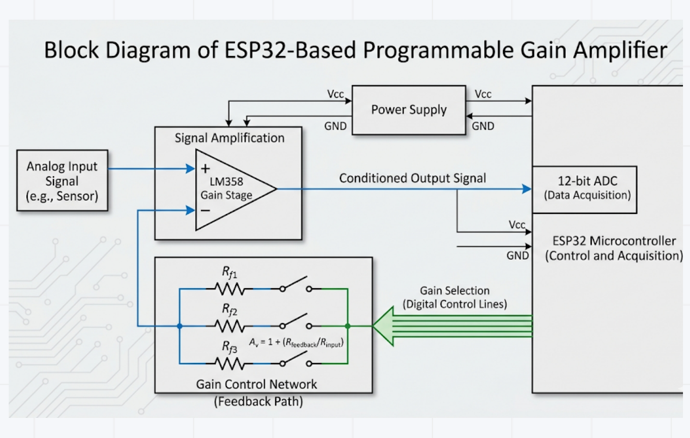

The system is divided into three primary stages:

- **Input Stage:** Low-amplitude analog signal source (Sensor/Transducer).
- **Processing Stage:** LM358 Operational Amplifier in a non-inverting configuration for high input impedance.
- **Control Stage:** ESP32 Microcontroller managing the feedback network to dynamically switch gain levels.
- **Output Stage:** Conditioned signal routed to the ESP32's 12-bit ADC for digital processing.

The gain of the system is governed by the non-inverting closed-loop transfer function:

**A_v = 1 + R_feedback / R_input**

- **A_v:** Closed-loop voltage gain
- **R_feedback:** Feedback resistance (controlled by ESP32)
- **R_input:** Ground-referenced input resistance

## Component Selection

### The Analog Stage: LM358 Dual Op-Amp

- **Single Supply Operation:** Functions efficiently on a single rail (3.3V to 5V), eliminating the need for complex dual-power circuitry.
- **Common-Mode Input Range:** Includes Ground, which is critical for sensing low-level signals that reside near 0V.
- **Internal Frequency Compensation:** Simplifies circuit design by ensuring stability across the usable bandwidth without external capacitors.
- **Cost-Efficiency:** High performance-to-cost ratio for industrial signal conditioning prototypes.

### The Processing Core: ESP32

- **12-bit ADC Resolution:** Provides 4,096 discrete levels, allowing for high-precision sampling of the amplified signal compared to the 10-bit ADC of traditional microcontrollers.
- **High-Speed Processing:** Dual-core architecture ensures real-time gain switching and signal processing without latency.
- **3.3V Logic Compatibility:** Seamlessly interfaces with modern low-power sensors and digital potentiometers.
- **IoT Ready:** Integrated Wi-Fi/Bluetooth allows for remote gain adjustment and cloud-based data logging.

### LM358 vs UA741

| Feature | LM358 (Selected) | UA741 (Standard) |
|---|---|---|
| Supply Type | Single Supply (3V-32V) | Dual Supply (+/-5V to +/-15V) |
| Input Swing | Includes Ground (0V) | Limited (Cannot reach 0V) |
| Integration | Dual Op-Amps in 1 IC | Single Op-Amp in 1 IC |

## Hardware Interfacing & Circuit Schematic

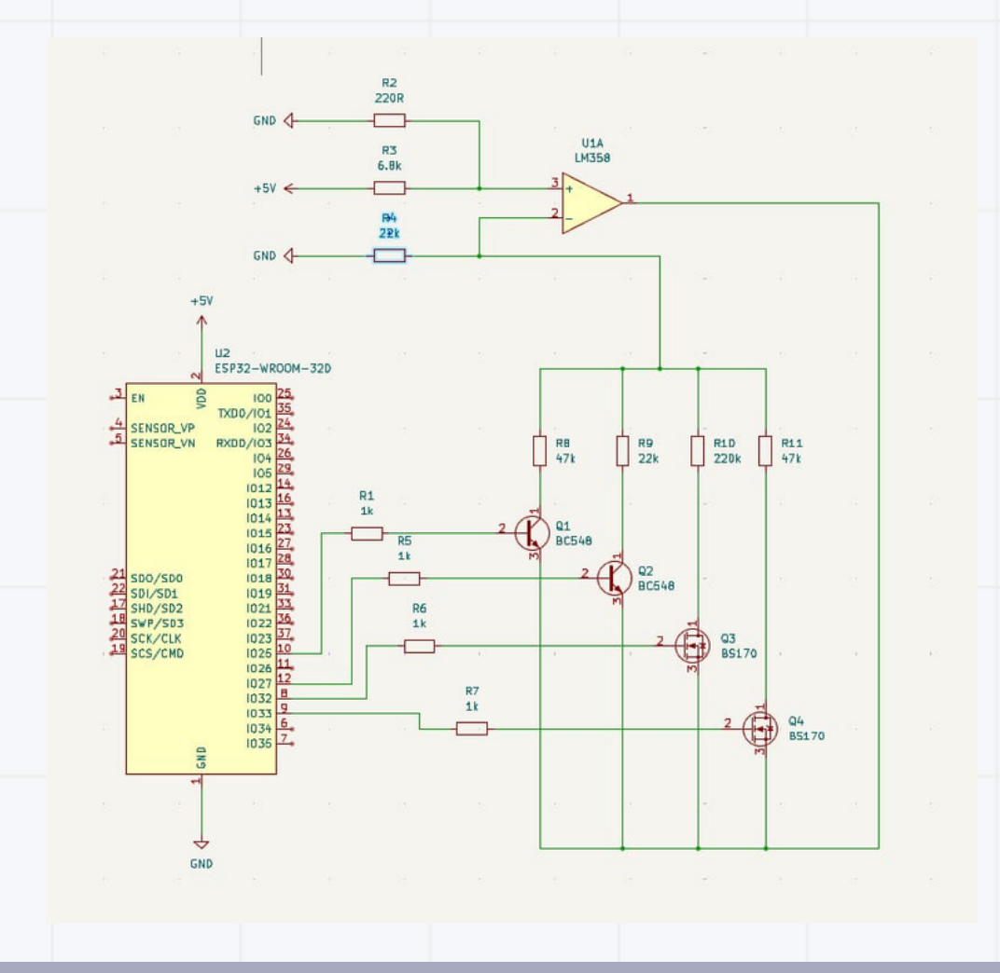

### Digitally Controlled Feedback Network

- **Switching Elements:** The circuit utilizes a hybrid switching array consisting of BC548 BJTs (Q1, Q2) and BS170 MOSFETs (Q3, Q4) to modulate the feedback resistance.
- **Logic-Level Control:** ESP32 GPIO pins (10, 11, 12, 8) act as digital triggers. When a pin is driven HIGH, the corresponding transistor enters saturation (for BJTs) or the ohmic region (for MOSFETs), completing the path for the specific feedback resistor.
- **Parallel Resistance Logic:** By switching multiple transistors simultaneously, the system can achieve various equivalent feedback resistances, allowing for discrete, programmable gain steps.

This design allows for a 4-bit Programmable Gain Control. By toggling these four switches, we aren't limited to just 4 gain settings; we can create 16 different gain combinations by using them in parallel. This gives the ESP32 the ability to perform 'Auto-Ranging,' choosing the best gain to keep the signal within the 12-bit ADC's optimal window.

## Simulation Results - DC Sweep Analysis

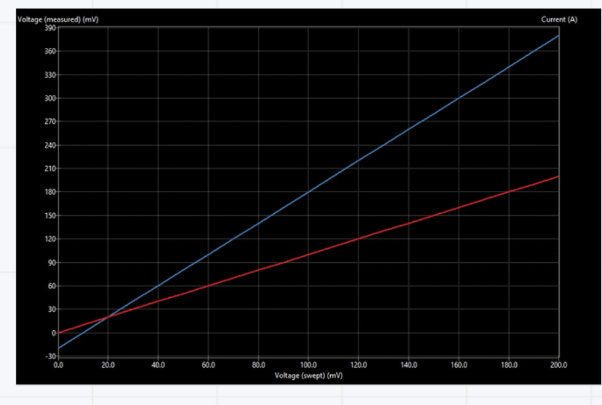

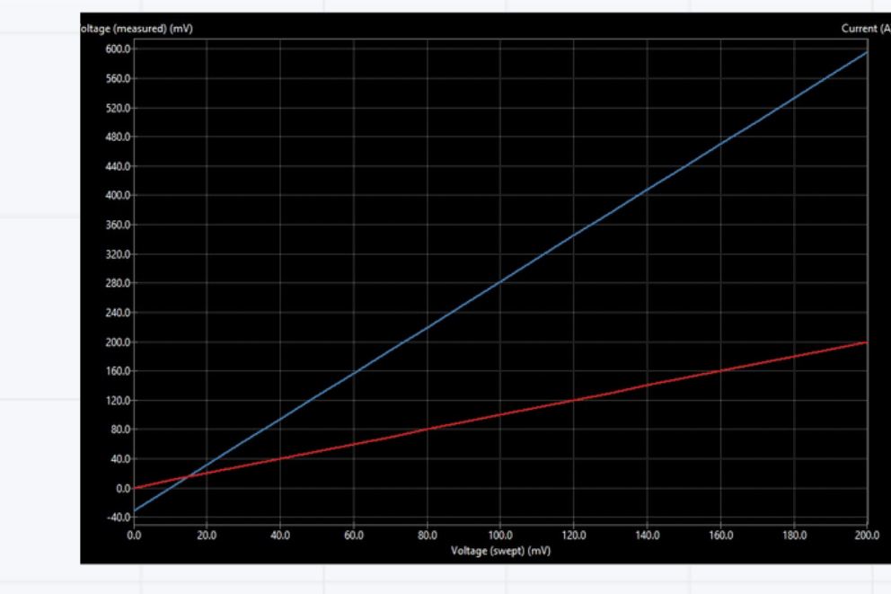

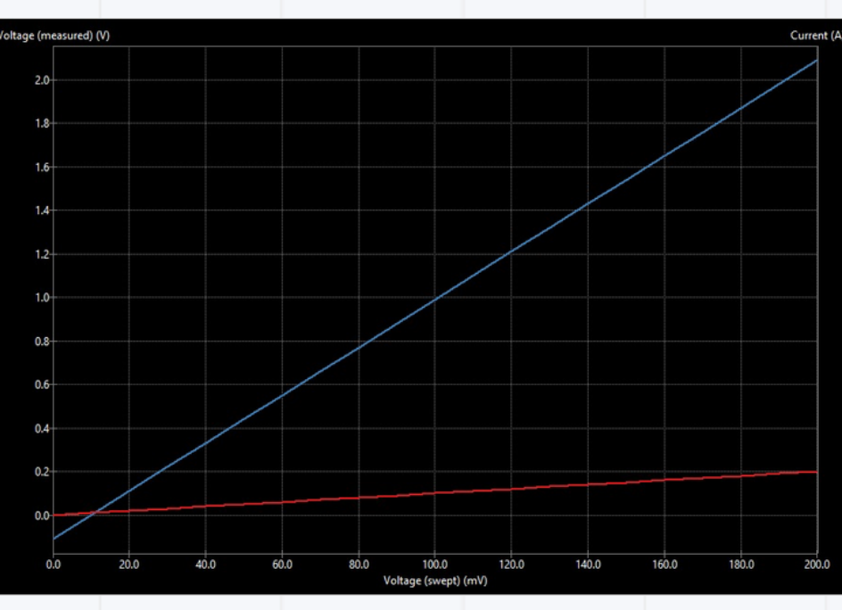

| Resistor (Rf) | Theoretical Gain | Simulated Gain | % Error |
|---|---|---|---|
| 22 kOhm | 2.00 | 1.999 | 0.01% |
| 47 kOhm | 3.14 | 3.112 | 0.57% |
| 220 kOhm | 11.0 | 10.4 | 5.45% * |

\* 68 kOhm used to eliminate off-state MOSFET parallel leakage observed at 220 kOhm.

## Serial Control

The gain level is chosen by typing `1` to `4` into the Arduino IDE Serial Monitor (115200 baud). The ESP32 replies with a confirmation line, e.g. `Success: Gain Level 3 Selected (220kOhm active).`

Resistor selected per gain level, from the serial output:

| Gain level | Resistor selected |
|-----------:|:------------------|
| 1 | 47 kOhm |
| 2 | 22 kOhm |
| 3 | 220 kOhm |
| 4 | 47 kOhm (a second 47 kOhm resistor) |

**Gain level 1**

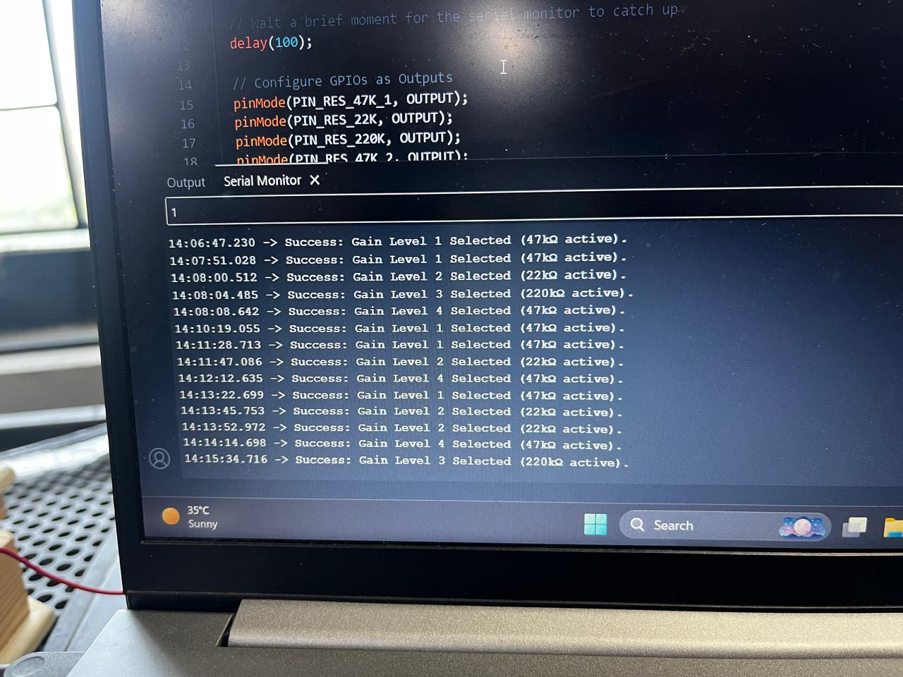

**Gain level 2**

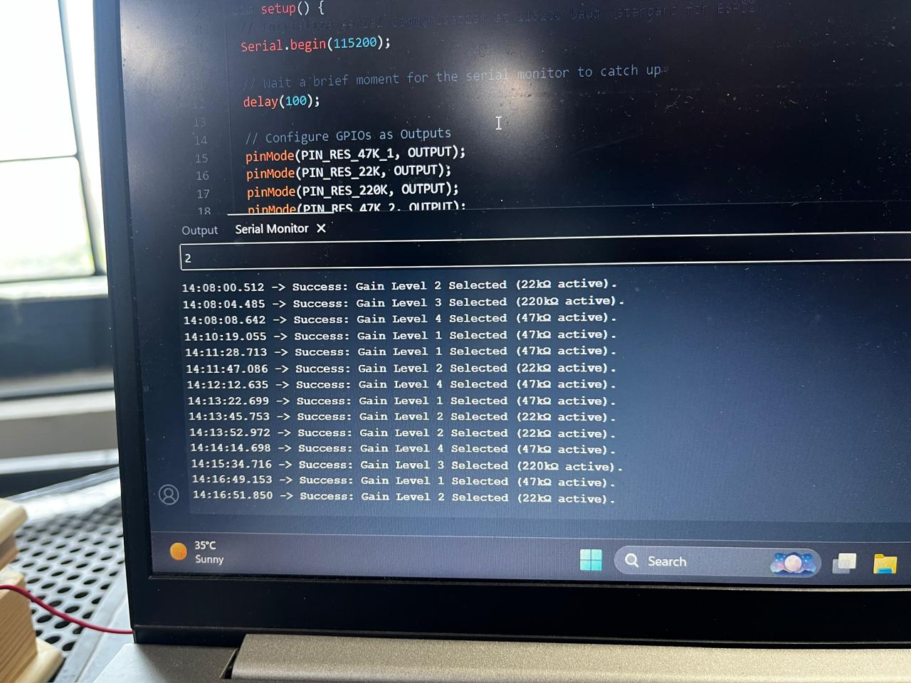

**Gain level 3**

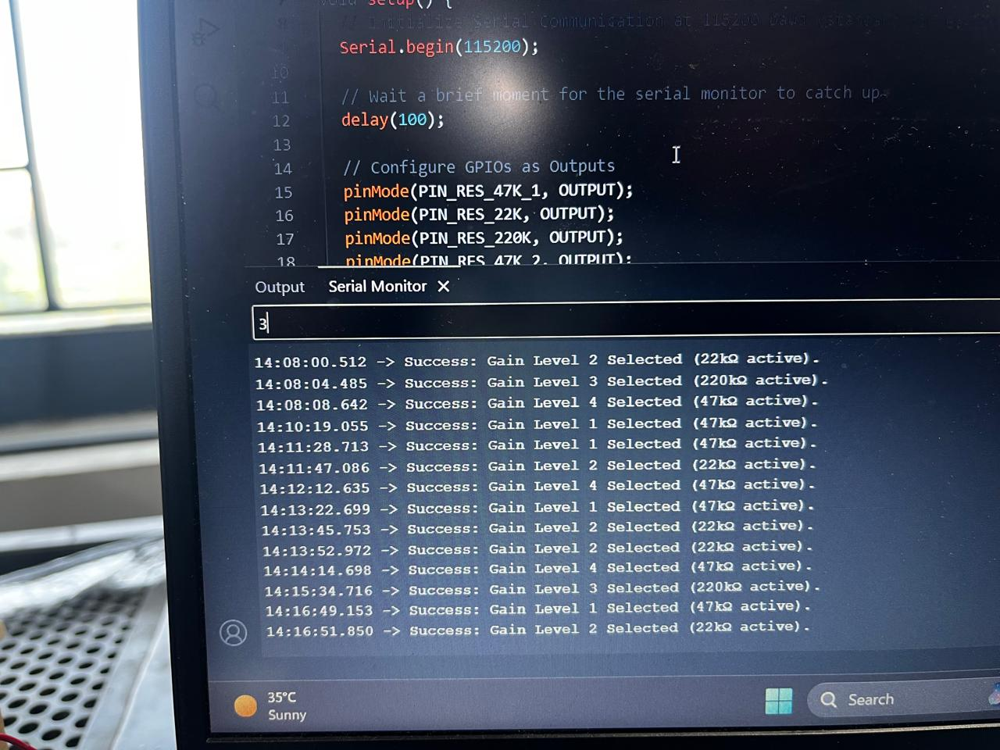

**Gain level 4**

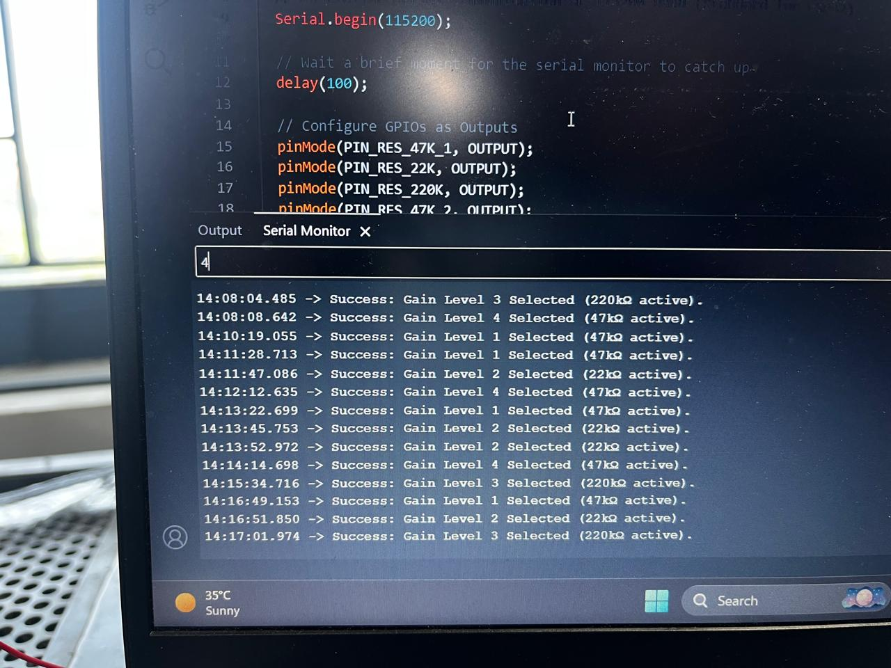

## Practical Hardware Analysis

Breadboard measurements from the project report:

| Setting | Gain | Multimeter reading |
|--------:|:----:|:-------------------|
| 1 | 3.14 | 0.501 V |
| 2 | 2 | 317.4 mV |
| 3 | 7 | 0.954 V |
| 4 | 3.14 | 0.497 V |

**Setting 1 (Gain = 3.14) - 0.501 V**

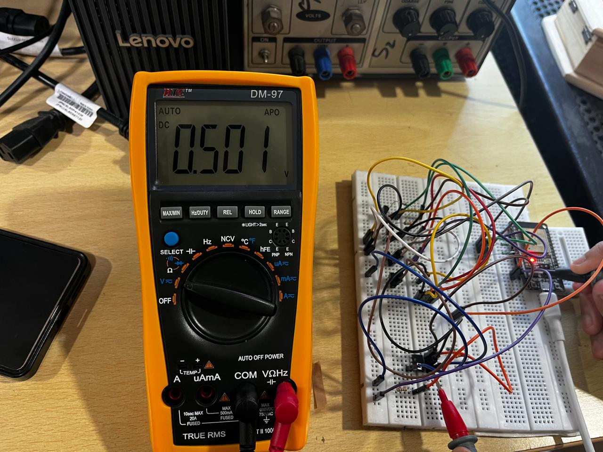

**Setting 2 (Gain = 2) - 317.4 mV**

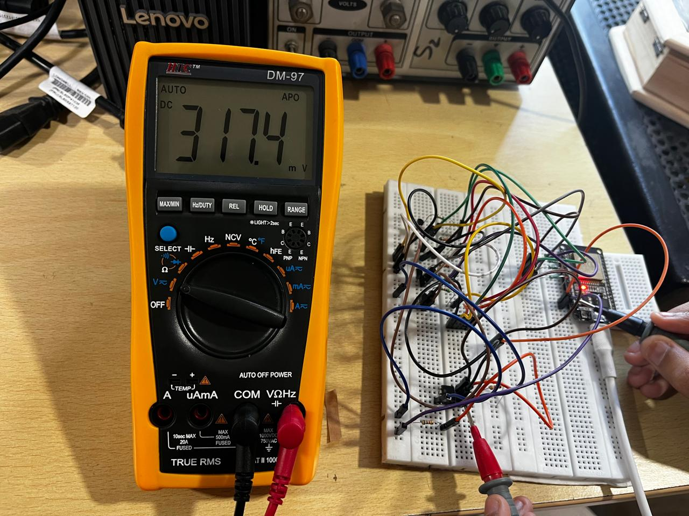

**Setting 3 (Gain = 7) - 0.954 V**

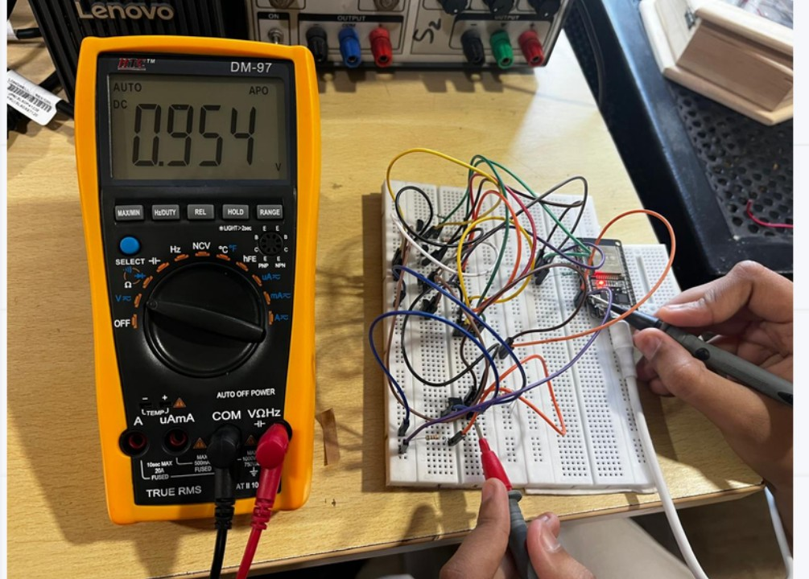

**Setting 4 (Gain = 3.14) - 0.497 V**

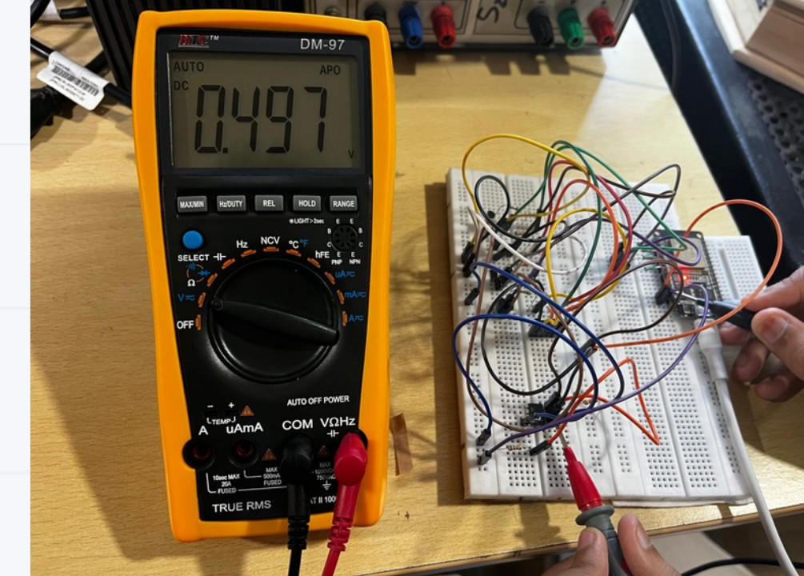

## Practical Simulation & System Demonstration

The full experimental sequence, including real-time auto-ranging and discrete gain state transitions: [Video Link (Google Drive)](https://drive.google.com/drive/folders/1uAmmMJL-uCcCc1qk7ha_o9YpzHiacfq2)

- **Video Coverage:** Verification of 22 kOhm, 47 kOhm, and 220 kOhm feedback paths.
- **Logic Proof:** Simultaneous Serial Monitor logging confirms the ESP32's 4-bit command execution.
- **Dynamic Response:** Observation of the LM358 output stabilizing within < 15 ms of a switching event.

Local demo clips:

- [Demo 1](media/videos/demo-1.mp4)
- [Demo 2](media/videos/demo-2.mp4)
- [Demo 3](media/videos/demo-3.mp4)
- [Demo 4](media/videos/demo-4.mp4)

## Conclusion

- **Successful Implementation:** Developed a robust Software-Defined Analog Front-End using a 4-bit hybrid switching matrix (BJT + MOSFET).
- **High-Precision Control:** Achieved discrete gain steps with a measured hardware accuracy of 97.5%, correlating closely with Proteus simulations.
- **Dynamic Range Optimization:** Successfully demonstrated Auto-Ranging logic, allowing the ESP32 to prevent signal clipping and maximize ADC resolution in real-time.

## Future Scope & Scalability

- **IoT Integration:** Leveraging the ESP32's Wi-Fi stack to stream live amplified sensor data to a Blynk/ThingSpeak dashboard for remote industrial monitoring.
- **Hardware Refinement:** Transitioning from breadboard to a Double-Layer PCB to eliminate parasitic capacitance and reduce the noise floor.
- **Precision Upgrades:** Replacing the LM358 with a Rail-to-Rail Op-Amp (e.g., AD8605) to utilize the full 0-5V dynamic range without saturation.
- **AI Integration:** Implementing an Edge-AI model (like TinyML) on the ESP32 to classify signal patterns after they have been conditioned by the PGA.

## TODO

- [ ] Add the ESP32 firmware (not in this repo yet)
- [ ] Document the input signal (type, amplitude, frequency) - not specified in the report
- [ ] Reconcile Setting 3 in the report's practical measurements (Gain = 7) with gain level 3 in the serial logs (220 kOhm selected, theoretical gain 11)
